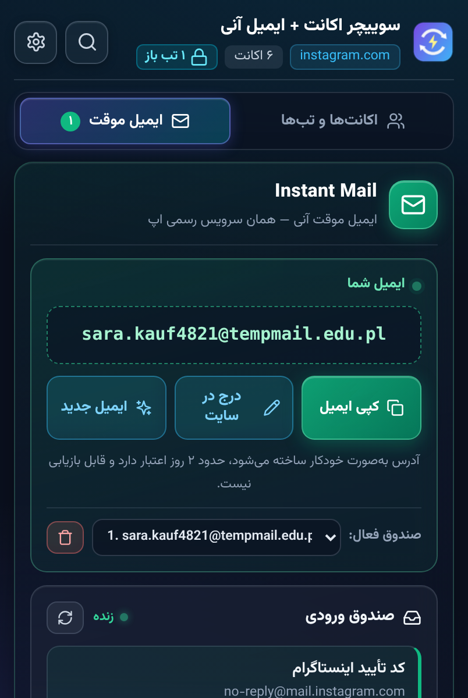
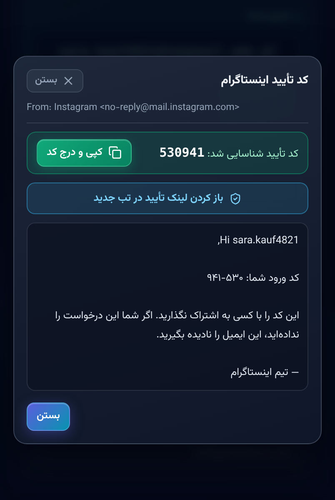
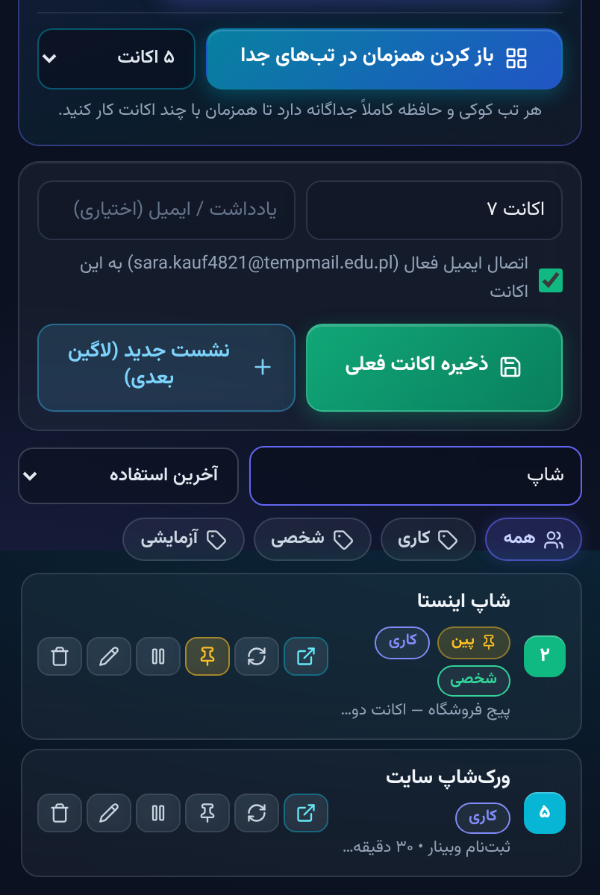

# نیک‌بروزر — Nik Browser

مرورگر اختصاصی اندروید با **موتور فایرفاکس (GeckoView)** که سوییچر مولتی‌اکانت و موتور ایمیل موقت به‌صورت **داخلی و ممتاز** توش بومی‌سازی شده. نه استور لازم داره، نه نصب افزونه، نه امضا — همه‌چیز از همون اول داخل خود مرورگره.

> این پروژه برادرِ بومیِ افزونهٔ کروم [multi-account-switcher](https://github.com/Nikzadcrr/multi-account-switcher) است؛ همون موتور، این‌بار داخل یک مرورگر کامل روی موتور Gecko.

## چرا GeckoView؟

GeckoView همون موتوریه که فایرفاکس اندروید روش سواره — متن‌باز (MPL-2.0)، سبک‌تر از فورک کل فایرفاکس، و مهم‌تر از همه: **پشتیبانی رسمی از افزونه‌های داخلی (Built-in WebExtension)**. افزونهٔ ما از پوشهٔ `assets` خود APK بالا میاد و مثل یک بخش اصلی مرورگر با دسترسی ممتاز اجرا می‌شه؛ یعنی حذف‌نشدنیه و به هیچ فروشگاه افزونه‌ای وابسته نیست.

## امکانات

**مرورگر:**
- موتور کامل Gecko (همون فایرفاکس اندروید)
- تب‌های چندگانه با پنجرهٔ مدیریت تب
- نوار آدرس هوشمند (آدرس مستقیم یا جست‌وجو)
- دانلود فایل با DownloadManager اندروید
- تم تیرهٔ اختصاصی و رابط راست‌به‌چپ فارسی

**موتور داخلی سوییچر + ایمیل موقت (نسخهٔ ۴.۰.۰):**
- ذخیرهٔ ۳۰+ اکانت در هر سایت و جابه‌جایی یک‌کلیکی
- باز کردن همزمان اکانت‌ها در تب‌های مجزا
- ساخت آنی ایمیل موقت و کپی فوری آدرس
- تشخیص خودکار کد تأیید (OTP) و اعلان دسکتاپ/اندروید
- لیبل‌بندی (کاری، شخصی، آزمایشی)، سنجاق و مرتب‌سازی بر اساس آخرین استفاده
- جست‌وجوی سریع بین اکانت‌ها و ایمیل‌ها
- باز شدن لینک‌های ثبت‌نام و تأیید در تب جدید

## نصب

۱. از بخش [Releases](https://github.com/Nikzadcrr/NikBrowser/releases) آخرین APK رو بگیر (یا از [Actions](https://github.com/Nikzadcrr/NikBrowser/actions) خروجی هر بیلد رو دانلود کن).
۲. روی گوشی نصبش کن (اجازهٔ نصب از منابع ناشناس رو بده).
۳. بازش کن — اولین صفحه خودش پنل ایمیل موقته. دکمهٔ سبز ✉ هم همیشه پنل رو باز می‌کنه.

## بیلد از سورس

```bash
git clone https://github.com/Nikzadcrr/NikBrowser.git
cd NikBrowser
./gradlew :app:assembleDebug
# خروجی: app/build/outputs/apk/debug/app-debug.apk
```

بیلد CI هم آماده‌ست: هر push به `main` توی GitHub Actions بیلد می‌شه و APK به‌عنوان artifact آپلود می‌شه؛ هر تگ `v*` هم یه Release با APK می‌سازه.

## ساختار پروژه

```
├── app/src/main/
│   ├── java/dev/nikzad/nikbrowser/MainActivity.java   ← مرورگر (تب‌ها، نوار آدرس، دانلود)
│   ├── assets/extensions/nikmail/                     ← افزونهٔ داخلی (کل موتور)
│   │   ├── manifest.json                              ← پورت‌شده برای Gecko (event page)
│   │   ├── background.js / popup.* / content.js
│   └── res/                                           ← رابط کاربری
├── docs/screenshots/                                  ← اسکرین‌شات‌ها
└── .github/workflows/android.yml                      ← بیلد خودکار APK
```

## نحوهٔ تلفیق افزونه

۱. افزونه داخل `app/src/main/assets/extensions/nikmail/` قرار می‌گیره.
۲. موقع استارت، `WebExtensionController.ensureBuiltIn()` اون رو با شناسهٔ `nikmail@nikzad.dev` نصب می‌کنه — بدون امضا، بدون استور، با دسترسی ممتاز.
۳. آدرس پایهٔ افزونه (`moz-extension://…`) گرفته می‌شه و دکمهٔ ✉ همون‌جا `popup.html` رو تمام‌صفحه باز می‌کنه.
۴. برای سازگاری با Gecko، `background.service_worker` به event page (`background.scripts`) تبدیل شده و `browser_specific_settings.gecko.id` اضافه شده؛ بقیهٔ کد افزونه دست‌نخورده‌ست.

## محدودیت‌های فعلی

- دیالوگ‌های جاوااسکریپت (alert/confirm) فعلاً بی‌صدا رد می‌شن (PromptDelegate کامل تodo است).
- میان‌برهای صفحه‌کلید افزونه (Alt+Shift+F و…) روی موبایل معنی ندارن و نادیده گرفته می‌شن.

## لایسنس و سپاس

- کد مرورگر: MPL-2.0 (مطابق GeckoView موزیلا)
- موتور: [GeckoView](https://mozilla.github.io/geckoview/) — دست موزیلا و جامعهٔ فایرفاکس درد نکنه
- افزونهٔ کروم همتا: [Nikzadcrr/multi-account-switcher](https://github.com/Nikzadcrr/multi-account-switcher)

## اسکرین‌شات‌ها

| پنل ایمیل موقت | کد تأیید خودکار |
| --- | --- |
|  |  |

| سوییچر اکانت | جست‌وجوی سریع |
| --- | --- |
|  |  |
